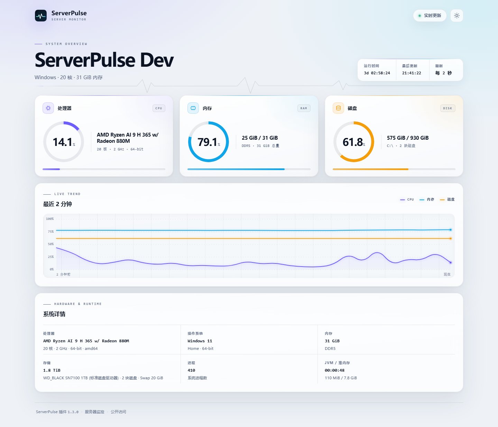
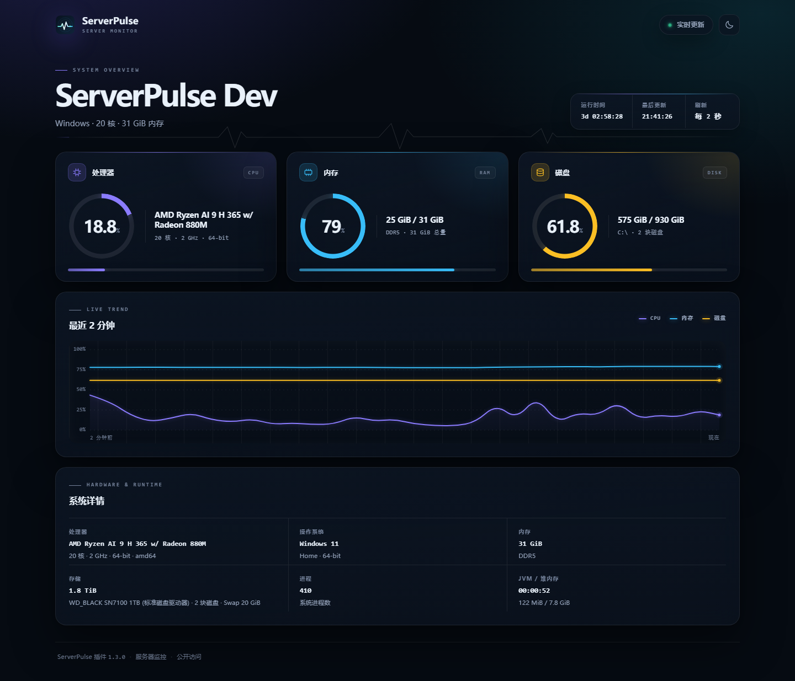
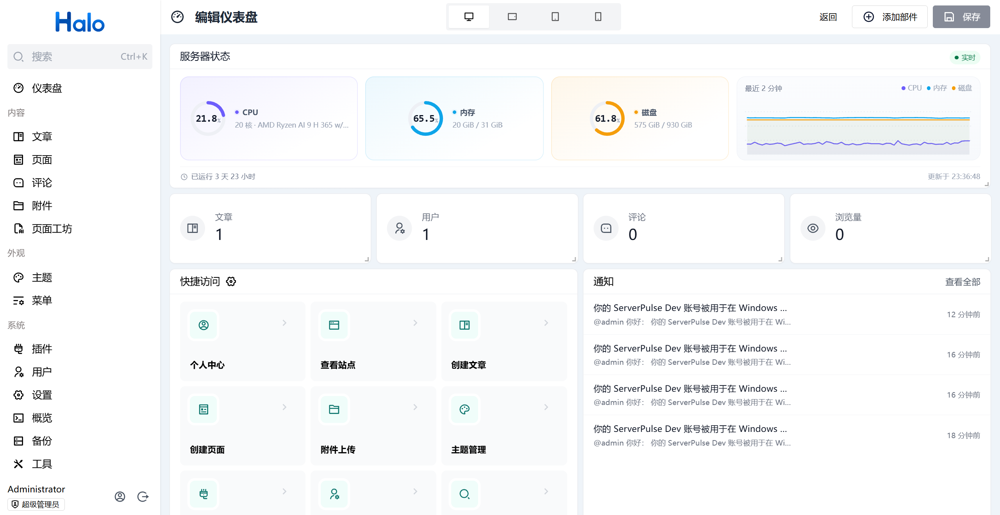
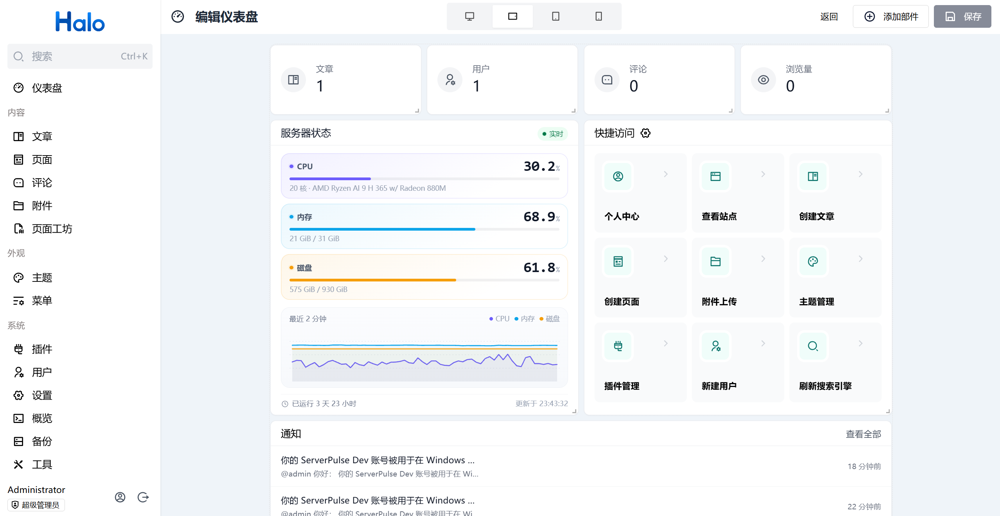
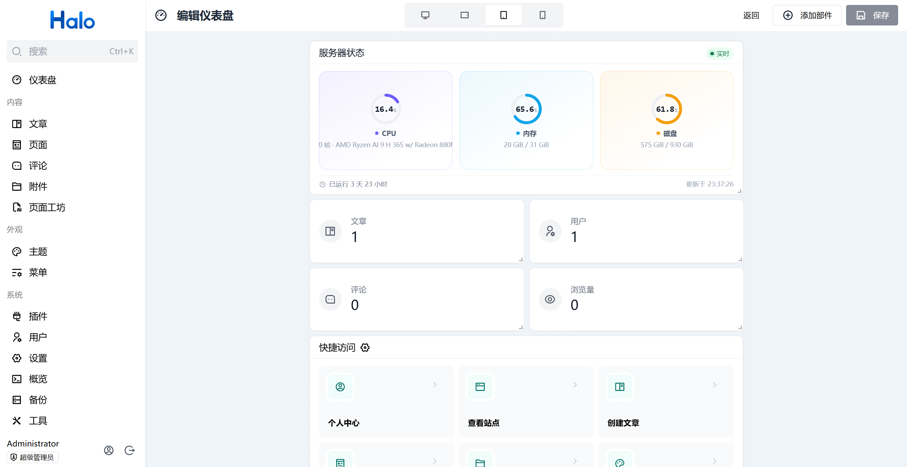
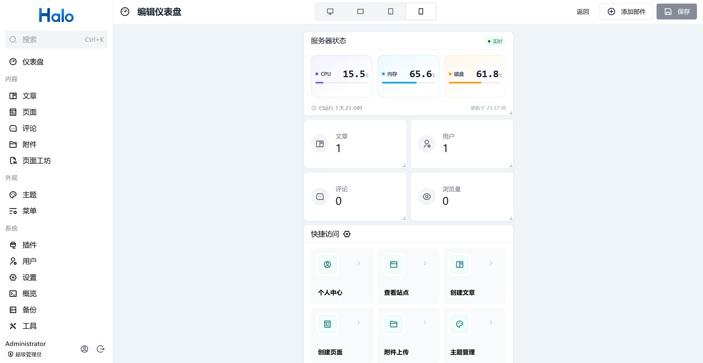

# ServerPulse 服务器监控（Halo 插件）

为 Halo 提供服务器监控能力，支持两种访问方式：独立监控页 `/pulse` 与 Halo 控制台仪表盘部件。插件在 Halo 进程内直接读取指标，不需要额外 Agent、独立服务或数据库。

仓库：<https://github.com/litxiaoxi/halo-plugin-server-pulse>

| 访问方式 | 入口 | 说明 |
| --- | --- | --- |
| 独立监控页 | `/pulse` | 完整面板：CPU / 内存 / 磁盘、历史曲线、硬件详情，支持亮色、暗色和跟随系统主题。 |
| 控制台仪表盘部件 | `/console/dashboard` →「设置」→「添加部件」→「小部件中心」→「服务器」 | 在 Halo 控制台首页快速查看 CPU / 内存 / 磁盘、运行时间与硬件摘要，支持拖动缩放。 |

## 界面预览

### 独立监控页 `/pulse`

<p align="center">
  
  
</p>

### 控制台仪表盘部件

<p align="center">
  
  
</p>
<p align="center">
  
  
</p>

部件会根据仪表盘卡片的宽高自动切换：宽屏使用「指标卡 + 侧边趋势图」，窄而高使用「纵向指标 + 趋势图」，中等尺寸使用环形仪表卡，矮容器使用紧凑条形布局。预览时使用示例数据，添加到仪表盘后按插件设置的刷新间隔轮询。

## 功能

- CPU、内存、磁盘使用率与系统运行时间。
- CPU 型号、核心数、频率、架构，操作系统、内存类型、磁盘型号、Swap、进程数。
- 最近约 2 分钟的 CPU / 内存 / 磁盘历史曲线。
- JVM 运行时间与堆内存使用情况。
- 亮色、暗色、跟随系统三种主题。
- 响应式布局，适配桌面、平板和手机。
- Halo 设置表单：服务器名称、默认主题、刷新间隔、访问模式、历史曲线、详细硬件信息。
- 支持仅登录用户、公开访问、指定用户访问三种访问模式；默认为仅登录用户。
- OSHI 不可用时自动降级为 JVM 基础指标，不影响 Halo 启动。
- Halo 控制台仪表盘部件：在 `/console/dashboard` 点击右上角「设置」→「添加部件」→「小部件中心」添加后，可直接查看 CPU、内存、磁盘、运行时间与硬件摘要。

## 环境要求

- Halo `>= 2.21.0`
- Java 21（Halo 2.21+ 的运行时要求）

## 安装

1. 在 Halo Console 的「插件」页面安装插件 JAR。
2. 启用插件。
3. 打开 `https://你的站点/pulse`。
4. 如需站点导航入口，在 Halo「菜单」中添加一个指向 `/pulse` 的自定义链接。
5. 如需在控制台首页查看：打开 `/console/dashboard` → 右上角「设置」→「添加部件」→「小部件中心」→ 选择「服务器」分组中的 ServerPulse 部件 → 保存。

## 设置

插件详情页提供以下设置：

| 设置 | 默认值 | 说明 |
| --- | --- | --- |
| 服务器名称 | 空 | 留空时使用站点标题。 |
| 默认主题 | 跟随系统 | 访客仍可在页面右上角切换。 |
| 刷新间隔 | 2 秒 | 允许 1–30 秒；页面隐藏时暂停轮询。 |
| 访问权限 | 仅登录用户 | 可选公开访问或指定用户访问。 |
| 指定用户 | 空 | 仅在「指定用户访问」模式下生效；未选中的登录用户会收到 403。 |
| 显示历史曲线 | 开启 | 展示最近约 2 分钟的三项指标趋势。 |
| 显示详细硬件信息 | 开启 | 关闭后服务端也会省略 CPU 型号、系统、磁盘、进程数等详细信息。 |

### 访问控制

- **仅登录用户（默认）**：匿名访客打开 `/pulse` 只能看到登录引导，监控 API 返回 401。
- **公开访问**：任何访客都能看到监控数据。请确认你接受 CPU 型号、操作系统、磁盘等服务器信息被公开。
- **指定用户访问**：只有被选中的 Halo 用户能查看监控数据；匿名访客返回 401，未授权的登录用户返回 403。

插件只申请 `api.serverpulse.halo.run` 下 `metrics` 资源的只读权限，没有写操作、数据库或外部服务。

## 接口

`/pulse` 页面和控制台仪表盘部件都通过只读接口获取数据：

```text
GET /apis/api.serverpulse.halo.run/v1alpha1/metrics
```

匿名访问时仍受 Halo 权限和插件访问设置控制；默认返回 401，公开模式开启后才允许匿名读取。指定用户模式下，未被授权的登录用户返回 403。

## 控制台仪表盘部件

- 在 Halo 控制台首页 `/console/dashboard` 点击右上角「设置」→「添加部件」→「小部件中心」→「服务器」分组，添加 ServerPulse 部件并保存。
- 部件展示 CPU、内存、磁盘三项指标，以及运行时间、硬件摘要和实时状态；较大尺寸下展示最近 2 分钟趋势曲线。
- 部件右上角齿轮可配置标题、是否显示运行时间和硬件信息。
- 部件沿用上面的访问策略；当前账号无权查看时显示「无查看权限」，不会绕过服务端权限。
- 部件预览使用示例数据，不会发起请求；添加到仪表盘后按插件设置的刷新间隔轮询，页面隐藏时暂停。

## 指标口径

- 指标从 Halo 所在进程/主机读取。Halo 使用 Docker 时，CPU、内存、进程数等可能反映宿主机或容器可见值，具体取决于运行环境和 cgroup 配置。
- 磁盘使用率优先取系统盘（Windows `SystemDrive`）或根分区 `/`；物理磁盘总量单独展示，避免重复累加多个挂载点。
- 历史数据只保存在内存中，Halo 重启或插件重载后清空。
- 如果 OSHI/JNA 在当前部署环境不可用，页面会显示“部分硬件信息不可用”，并使用 JVM 基础指标降级。

## 主题覆盖

`/pulse` 默认使用插件内置的独立模板 `templates/pulse.html`。如果当前主题提供了同名 `pulse.html`，会优先使用主题模板。传给模板的稳定字段包括 `pulseTheme`、`apiBase`、`pluginName`、`pluginVersion` 和 `_templateId`（`plugin:server-pulse:pulse`）。主题覆盖时应保留这些字段的语义。

## 隐私

插件不收集、不上传、不向第三方发送任何数据；不加载 CDN、外部字体、统计脚本或广告。所有前端资源都随插件 JAR 分发。详见 [隐私说明](docs/PRIVACY.md)。

## 开发

需要 JDK 21、Node.js 22+ 与 pnpm 10。Windows 本机可使用：

```bash
set JAVA_HOME=D:\Develop\jdk\jdk-21
gradlew.bat clean build
```

或 Git Bash / macOS / Linux：

```bash
JAVA_HOME=/path/to/jdk-21 ./gradlew clean build
```

构建产物位于 `build/libs/`。Gradle 会自动执行 `ui/` 子工程中的 `pnpm install`、Vite 构建和 `vue-tsc` 类型检查，并将 `console/main.js`、`console/style.css` 打进插件 JAR。

只调整控制台界面时，可单独运行：

```bash
cd ui
pnpm install
pnpm build        # 输出 ui/build/dist
pnpm type-check
```

本地 Halo 联调实例可按 [docs/RELEASE.md](docs/RELEASE.md) 手动启动；`ui` 的 dev 模式会直接写入 `build/resources/main/console`，方便配合本地实例热更新。

### 本地 Halo 联调

本项目没有 Docker 依赖。可使用 Halo 官方 JAR + H2 在本机验证，步骤见 [docs/RELEASE.md](docs/RELEASE.md)。

## 兼容性

- 使用 Halo 2.21.0 API 编译，声明兼容 `>= 2.21.0`。
- 控制台仪表盘部件依赖 Halo 2.21.0 起提供的 `console:dashboard:widgets:create` 扩展点。
- 发布前应在 Halo 2.21.x 与当前 Halo 2.27.x 上分别验证安装、启用、页面、权限、禁用、重启和仪表盘部件。

## 许可

本项目为原创项目，代码以 MIT 许可证发布。第三方依赖 OSHI（Apache-2.0）和 JNA（LGPL-2.1-or-later / Apache-2.0）的许可证与版权声明见 [NOTICE](NOTICE)，依赖说明见 [docs/ATTRIBUTION.md](docs/ATTRIBUTION.md)。

